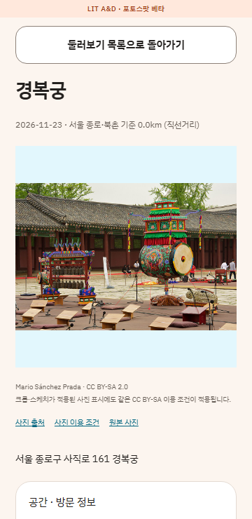
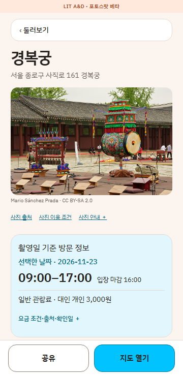
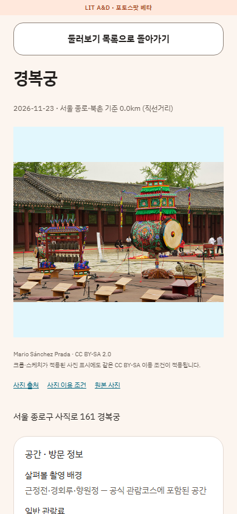
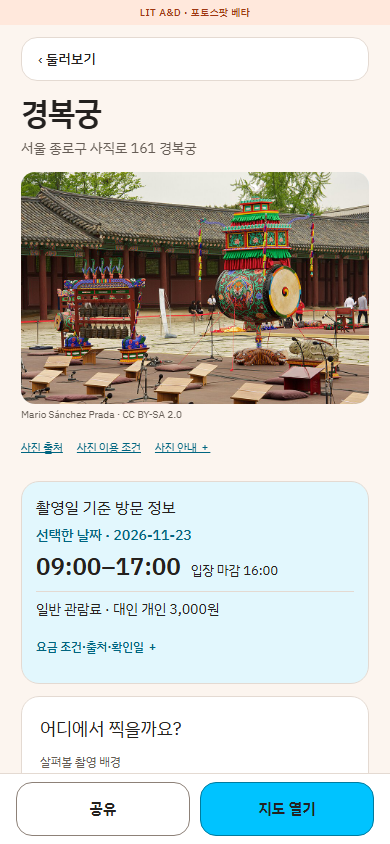

# 모바일 공개 장소 상세 · Figma B안 검토 (2026-11-20)

기준: main `b3a29b30b16ae7c5cd19cabaabbe2a366fb88f11` 및 [Figma 오른쪽 B안](https://www.figma.com/design/hAsKyAvR7bxBF2EPC2otpT?node-id=2-6). `/browse/[id]` 변경만 검토하며 병합·운영 배포하지 않는다. 기존 #41(대문·목록), #42(검색 메타)의 변경을 가져오지 않았다.

## 화면과 데이터

- 장소명·주소 → 원본 비율 대표사진 → 촬영일 기준 방문 정보 → 촬영 배경·공식 관람코스 → 상세 방문 안내·사용자 촬영 예시·맞춤 추천 순서다. 3색 테마와 기존 공개 경로를 유지한다.
- 사진은 실제 이미지의 가로세로 비율로 표시한다. 알려진 원본 크기는 로딩 중 공간 확보에만 사용하며, 정사각형 프레임·크롭을 적용하지 않는다. 저작자·라이선스명·출처/이용 조건 링크는 항상 표시하고 원본 링크와 추가 사진 안내는 펼쳐본다. 사진 없는 곳은 기존 `사진 준비 중` 문구를 쓴다.
- 선택 날짜, 확인된 시간표, 입장 마감, 일반 관람료를 모았다. 휴관·휴무, 시간 미확인/만료, 요금 미확인을 구분한다. 요금의 대상·면제 조건과 출처·확인일은 펼쳐볼 수 있다. 요금은 등록된 일반 안내이며 방문일의 특별 개방·할인을 자동 추정하지 않는다.
- 입장 마감은 **유효한 공식 시간표 + 명확한 단일 당일 운영 구간 + 하나의 명시적 공식 안내**가 있을 때만 표시한다. 검수된 상대 안내(예: 관람 종료 N시간 전)는 선택 날짜의 종료 시각으로 계산한다. 조건부·충돌·자정을 넘기는 운영 구간·미확인·만료 안내는 시간을 만들지 않고 원문을 상세 안내에 유지한다. 24시간·분할 운영 등도 등록 문구를 유지한다.
- [궁능유적본부 관람시간](https://royal.khs.go.kr/ROYAL/contents/R702000000.do), [관람료](https://royal.khs.go.kr/ROYAL/contents/R703000000.do), [경복궁 관람코스](https://royal.khs.go.kr/ROYAL/contents/R701000000.do)를 2026-11-20 열어 기존 데이터와 대조했다. 11월의 09:00–17:00/입장 마감 16:00, 일반 대인 개인 3,000원 및 대상 조건을 확인했다. 화면 값은 이 장소명을 분기하거나 Figma 값을 하드코딩하지 않고 기존 API 응답으로 만든다. 데이터 파일의 확인일은 변경하지 않았다.
- 모바일(<680px) 하단 공유·지도 영역은 스크롤 본문 밖, SafeArea 안에 둔다. 본문 위에 겹쳐 띄우지 않는다. 데스크톱은 본문 내 버튼으로 제공한다. 공유 주소에 기존 도시·날짜를 유지하며 검색 canonical·사이트맵은 변경하지 않는다.
- `장소 저장` 버튼은 추가하지 않았다. 비로그인 저장 위치·보관 범위, 로그인 후 동기화/충돌 규칙, 저장·해제 동작을 결정하는 별도 후속 작업이다.

## 전후 캡처

경복궁, 서울, 2026-11-23. 변경 전은 main과 `app/api/client/deploy/vercel` 코드 차이가 없는 기존 `78af8b4` 빌드를 사용했다. 변경 후는 이 브랜치의 로컬 빌드다. 캡처에서 실제 이미지 다운로드·디코딩 완료를 기다렸다.

| 화면 | 변경 전 | 변경 후 |
|---|---|---|
| 360×740 |  |  |
| 390×844 |  |  |
| 1280×900 | [데스크톱 전](before-1280.png) | [데스크톱 후](after-1280.png) |

상태별 360px: [긴 이름](long-name-360.png), [사진 없음](no-photo-360.png), [11/24 휴궁](closed-360.png), [시간·요금 미확인](unknown-360.png), [시간표 재확인 필요](stale-360.png).

사진 출처: [2012-05-11 Gyeongbokgung.jpg](https://commons.wikimedia.org/wiki/File:2012-05-11_Gyeongbokgung.jpg), Mario Sánchez Prada, [CC BY-SA 2.0](https://creativecommons.org/licenses/by-sa/2.0). 캡처에 포함된 사진은 기존 카탈로그 사진이며 비율을 유지해 축소 표시했다. 새 대표사진을 등록하지 않았다.

## 검증 결과

| 검증 | 결과·범위 |
|---|---|
| 앱 타입 검사 | 통과 |
| 앱 단위 테스트 | 29개 스크립트 통과. 입장 마감의 계절별 종료 시각·명시 시각·조건부·충돌·만료·미확인, 사진 비율/권리 처리 포함 |
| 클라이언트 테스트 | 24개 통과 |
| 공개 API·운영시간 회귀 | `tests/test_public_browse.py tests/test_place_hours.py`: 29개 통과. 격리된 카탈로그 사본/테스트 자료 사용 |
| 웹 빌드 | 공식 빌드 절차 및 최종 Expo 웹 export/동일 정적 파일 마무리 통과 |
| 새 상세 E2E | 360×740, 390×844, 1280×900 Chromium 통과. 정상·긴 이름·사진 없음·휴관·시간/요금 없음·만료 상태, 가로 넘침 없음, 두 버튼 44px 이상, 스크롤 후에도 하단 고정/마지막 맞춤 버튼 가림 없음 |
| 실제 카탈로그·사진 확인 | 로컬 사본의 경복궁 11/23 시간/요금, 11/24 휴궁, 실제 외부 사진의 완전 로딩과 원본 비율 확인. 출처·이용 조건·원본·공식 관람코스 링크 유지 |
| CI용 고정 테스트 | 같은 E2E를 고정 응답과 테스트 이미지로도 통과. 브라우저 날짜를 2026-11-20으로 고정하며, CI 이미지 대체는 화면 기능 검증용으로만 사용한다 |
| 새 비로그인 공유 | 기존 공유 버튼 → 복사한 주소 → 새 브라우저 컨텍스트: 동일 장소·서울·2026-11-23 확인. 지도 버튼은 네이버 지도 주소를 열도록 확인 |
| 기존 공개 탐색 | 모바일·데스크톱에서 도시/날짜 변경, 목록→상세, 공유·새로고침·뒤로, 맞춤 설정 중단/완료와 원래 장소 복귀, 없는 장소 처리 통과 |
| 기존 추천 흐름 | CI 전용 카탈로그에서 `release_smoke.py` 전체 통과: 추천 점수·카테고리 순서·촬영 조건·일진·상세·저장·설정·초기화, page error 0 |
| 개인정보·통계 | 앱 단위 테스트 및 비로그인 E2E에서 동의 전 통계 전송 0. 로컬 `traffic=test`, 운영 통계/접수 데이터에 쓰기 없음 |
| 데이터 보호 | `catalog/`, `pipeline/data/`, `api/`, `client/` 변경 없음. SQLite SHA256 전후 `12bd640466c8104ab2e331785f000526964c6c71ea1ce859b1bb0806f8e60996` 동일 |

실행 명령:

```text
npm --prefix app run typecheck
npm --prefix app test
npm --prefix client test
python -m pytest tests/test_public_browse.py tests/test_place_hours.py -q
node scripts/build-web-preview.cjs
python app/e2e/public_detail_mobile.py --url http://127.0.0.1:8331 --live
python app/e2e/public_detail_mobile.py --url http://127.0.0.1:8331
python app/e2e/public_browse_smoke.py --url http://127.0.0.1:8331
python -m scripts.load_catalog_fixture  # PLACE_CATALOG_DB=별도 CI 사본
python app/e2e/release_smoke.py --url http://127.0.0.1:8332
```

`release_smoke.py`를 처음 실제 10,022곳 카탈로그에 실행하면 첫 카드의 77.5점과 CI 표본의 기대값 42.5점이 달라 실패한다. 점수 기대값이나 기준은 수정하지 않고, 스크립트가 요구하는 `scripts.load_catalog_fixture` 고정 데이터로 다시 실행해 전체 통과했다. 이 실행 조건 차이를 앱 회귀 오류나 운영 점수 변경으로 처리하지 않았다.

## 남은 확인

- iPhone/Android 실기기, Safari 실브라우저와 스크린리더 직접 조작은 미실행. 이번 모바일 검증은 Chromium 뷰포트이며 실제 기기 검증으로 간주하지 않는다.
- 공식 입장 마감 근거가 없거나 조건이 모호한 장소에는 마감 시각을 추가하지 않는다. 별도 데이터 검수로 보강할 수 있다.
- 새 CI 실행 결과와 링크는 PR에 기록한다. 운영 배포·운영 데이터 변경은 이 작업에 포함하지 않는다.
